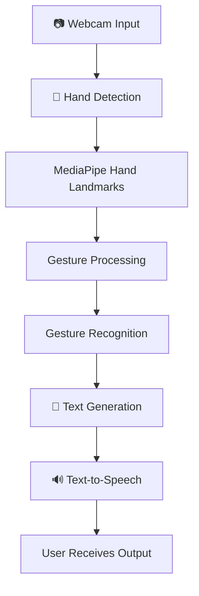

# 🤟 Sign Language to Voice/Text Conversion

\<h1 align="center">🤟 Sign Language to Voice & Text Conversion\</h1>

\<p align="center">   \<strong>Breaking Communication Barriers Through Technology\</strong> \</p>

\<p align="center">   An accessible, camera-based sign language recognition system designed to convert hand gestures into understandable text and speech. \</p>

\<p align="center">   \   \   \   \   \ \</p>

\<p align="center">   \<a href="[https://github.com/suryaprakashs0629/Sign-Language-To-Voice-Text-Conversion](https://github.com/suryaprakashs0629/Sign-Language-To-Voice-Text-Conversion)">GitHub Repository\</a> \</p>

---

## 📌 Table of Contents

1. [Project Overview](#-project-overview)
2. [Problem Statement](#-problem-statement)
3. [Proposed Solution](#-proposed-solution)
4. [Key Features](#-key-features)
5. [Technology Stack](#-technology-stack)
6. [System Architecture](#-system-architecture)
7. [How It Works](#-how-it-works)
8. [Project Structure](#-project-structure)
9. [Installation and Setup](#-installation-and-setup)
10. [How to Run the Website](#-how-to-run-the-website)
11. [Browser and Camera Permissions](#-browser-and-camera-permissions)
12. [Troubleshooting](#-troubleshooting)
13. [Screenshots](#-screenshots)
14. [Future Enhancements](#-future-enhancements)
15. [Academic Information](#-academic-information)
16. [Contributing](#-contributing)

---

## 🌍 Project Overview

**Sign Language to Voice/Text Conversion** is an assistive technology project that aims to make communication easier between sign language users and people who do not understand sign language.

The system uses a camera to capture hand gestures and applies computer vision and gesture recognition techniques to interpret them.

The recognized gestures are converted into text and can subsequently be communicated through speech output using Text-to-Speech technology.

The primary objective is to develop an affordable, accessible and user-friendly communication solution without requiring specialized hardware.

### 🎯 Project Objectives

- Develop a camera-based hand gesture recognition system.
- Recognize hand gestures using computer vision techniques.
- Convert recognized gestures into readable text.
- Generate speech output from recognized text.
- Provide a simple and accessible user interface.
- Explore the practical application of machine learning in assistive technology.

---

## ❗ Problem Statement

Communication between individuals who use sign language and individuals unfamiliar with sign language can be challenging.

Some existing solutions require expensive equipment, specialized devices or complicated systems.

There is a need for an accessible solution that can interpret hand gestures using commonly available hardware such as a computer camera.

This project explores a software-based approach to reducing these communication barriers.

---

## 💡 Proposed Solution

The proposed system captures hand gestures through a webcam, processes the visual information and identifies the corresponding sign.

The recognized sign is converted into text and speech, providing an alternative communication method.

The application combines a web-based user interface with computer vision and gesture recognition technologies.

---

## ✨ Key Features

| Feature                | Description                                              |
| ---------------------- | -------------------------------------------------------- |
| 📷 Camera Integration  | Captures hand gestures through a webcam.                 |
| 🤚 Hand Detection      | Detects hands from camera input.                         |
| 🧠 Gesture Recognition | Processes hand gestures to identify corresponding signs. |
| 📝 Text Conversion     | Converts recognized gestures into readable text.         |
| 🔊 Voice Output        | Uses Text-to-Speech technology to generate speech.       |
| 💻 Web Interface       | Provides a browser-based interface.                      |
| ♿ Accessibility        | Designed to support communication accessibility.         |
| 💰 Low-Cost Approach   | Uses commonly available computer hardware.               |

---

## 🛠️ Technology Stack

| Technology                | Purpose                                 |
| ------------------------- | --------------------------------------- |
| HTML5                     | Webpage structure                       |
| CSS3                      | Styling and user interface design       |
| JavaScript                | Frontend interaction and functionality  |
| Python                    | Backend and application-side processing |
| MediaPipe Hands           | Hand landmark detection                 |
| Computer Vision           | Processing visual hand information      |
| Machine Learning Concepts | Gesture recognition and classification  |
| Web Camera API            | Camera access through the browser       |
| Text-to-Speech            | Speech generation from recognized text  |

### Technology Categories

**Frontend**

- HTML5
- CSS3
- JavaScript

**Backend and Processing**

- Python
- Computer Vision
- MediaPipe Hands

**Input and Output**

- Webcam
- Text output
- Speech output

---

## 🏗️ System Architecture

The application follows a gesture-processing workflow.



### Architecture Explanation

| Stage | Process             | Description                                    |
| ----- | ------------------- | ---------------------------------------------- |
| 1     | Input               | Camera captures hand gestures.                 |
| 2     | Detection           | Hand regions are detected.                     |
| 3     | Landmark Extraction | Hand landmarks are extracted.                  |
| 4     | Processing          | Gesture information is processed.              |
| 5     | Recognition         | The corresponding gesture is identified.       |
| 6     | Text Generation     | Recognized information is converted into text. |
| 7     | Speech Generation   | Text is converted into speech.                 |

---

## ⚙️ How It Works

The general system workflow consists of the following stages:

**Step 1 – Camera Input**

The webcam captures the user's hand gestures.

**Step 2 – Hand Detection**

The system detects the hand present in the camera frame.

**Step 3 – Landmark Extraction**

MediaPipe Hands is used to identify hand landmarks for gesture processing.

**Step 4 – Gesture Processing**

The extracted hand information is processed for recognition.

**Step 5 – Gesture Recognition**

The system determines the corresponding sign.

**Step 6 – Text Conversion**

The recognized gesture is represented as readable text.

**Step 7 – Voice Generation**

The generated text is passed to a Text-to-Speech mechanism to produce audio output.

---

## 📁 Project Structure

The project workspace contains the following main components:

```text
Sign-Language-To-Voice-Text-Conversion/
│
├── index.html
│
├── css/
│   └── style.css
│
├── js/
│   └──
│
├── python/
│   └──
│
├── Open SignVoice Locally.bat
│
├── README.md
│
└── Other project files
```

| File / Folder                | Purpose                       |
| ---------------------------- | ----------------------------- |
| `index.html`                 | Main website interface        |
| `css/`                       | Stylesheet resources          |
| `js/`                        | JavaScript resources          |
| `python/`                    | Python application components |
| `Open SignVoice Locally.bat` | Windows application launcher  |
| `README.md`                  | Project documentation         |

*Note: The directory listing above describes the main workspace components. Refer to the repository for the complete file listing.*

---

## 💻 Installation and Setup

Follow these instructions to run the project on a Windows computer.

### 1. Prerequisites

Make sure the following are available:

| Requirement                    | Purpose                                               |
| ------------------------------ | ----------------------------------------------------- |
| Windows 10 / 11                | Operating system                                      |
| Python                         | Backend execution                                     |
| Google Chrome / Microsoft Edge | Running the web interface                             |
| Webcam                         | Capturing hand gestures                               |
| Internet Connection            | Downloading the project and any required dependencies |

### 2. Download the Project

Clone the repository using Git:

```bash
git clone https://github.com/suryaprakashs0629/Sign-Language-To-Voice-Text-Conversion.git
```

Alternatively:

1. Open the GitHub repository.
2. Click the green **Code** button.
3. Select **Download ZIP**.
4. Extract the downloaded ZIP file.
5. Open the extracted project folder.

### 3. Verify Python Installation

Open Command Prompt or PowerShell.

Execute:

```bash
python --version
```

Alternatively:

```bash
py --version
```

If Python is installed correctly, the installed version will be displayed.

If Python is not recognized, install it from:

[https://www.python.org/downloads/](https://www.python.org/downloads/)

During installation, enable the **Add Python to PATH** option.

### 4. Open the Project

Navigate to the extracted project directory.

You can also open the project in Visual Studio Code:

1. Launch VS Code.
2. Select **File → Open Folder**.
3. Select the project folder.
4. Open the project.

---

## ▶️ How to Run the Website

The project includes a Windows launcher named:

`Open SignVoice Locally.bat`

Follow these steps:

**Step 1:** Open the extracted project folder.

**Step 2:** Locate `Open SignVoice Locally.bat`.

**Step 3:** Double-click the batch file.

**Step 4:** Allow the launcher to execute. If Windows displays a security confirmation, verify that the file belongs to this project before allowing it.

**Step 5:** Wait for the application startup process to complete.

**Step 6:** If the launcher opens a browser automatically, use the opened page. Otherwise, follow the local address displayed in the terminal or command window.

**Step 7:** Allow camera access when requested by your browser.

**Step 8:** Start interacting with the application.

### Running Through Visual Studio Code

1. Open the project folder in VS Code.
2. Select **Terminal → New Terminal**.
3. Locate and execute the supplied Windows launcher from the project root, or double-click it in File Explorer.
4. Follow the startup instructions displayed in the terminal.

### Stopping the Application

If the application is running in a terminal window, press:

```text
Ctrl + C
```

This stops the running process.

> **Important:** The launcher is the supplied Windows startup method. Exact manual Python commands and dependency installation commands should be followed from the project's backend configuration rather than guessed.

---

## 📷 Browser and Camera Permissions

Camera access is necessary for capturing hand gestures.

When the browser asks for permission:

1. Select **Allow** for camera access.
2. Make sure the correct webcam is selected.
3. Ensure that no other application is exclusively using the camera.
4. Refresh the application if camera access was previously blocked.

For local browser development, camera access is generally supported on localhost.

---

## 🔧 Troubleshooting

| Problem                     | Possible Solution                                             |
| --------------------------- | ------------------------------------------------------------- |
| Python is not recognized    | Install Python and enable PATH configuration.                 |
| Camera is not opening       | Check browser camera permissions.                             |
| Camera is already in use    | Close other applications using the webcam.                    |
| Website does not load       | Check whether the local application has started successfully. |
| Launcher closes immediately | Run it from Command Prompt to inspect the displayed error.    |
| Gesture is not recognized   | Check camera positioning, lighting and hand visibility.       |
| No speech output            | Check browser audio settings and system volume.               |

---

## 🚀 Future Enhancements

The following improvements are planned possibilities for future development:

- 📚 Support for a larger sign language vocabulary.
- 🌐 Multi-language text and speech output.
- 🧠 Improved gesture classification using deep learning.
- 📱 Mobile application development.
- ☁️ Cloud-based model updates.
- ⚡ Improved recognition speed and accuracy.
- 🤝 Expanded accessibility features.
- 📊 Performance evaluation using larger gesture datasets.

---

## 🖼️ Screenshots and Demonstration

Screenshots of the application can be added here to demonstrate the user interface and system workflow.

Recommended screenshots:

| Screenshot       | What to Show                |
| ---------------- | --------------------------- |
| Home Page        | Main application interface  |
| Camera Interface | Live camera input           |
| Hand Detection   | Detected hand gestures      |
| Text Output      | Recognized text             |
| Voice Output     | Speech generation interface |

To add screenshots:

1. Create a folder named `screenshots` in the project root.
2. Save your actual application screenshots inside it.
3. Reference them in this section using Markdown.

Example:

```markdown

```

---

## 🎓 Academic Information

| Detail           | Information                              |
| ---------------- | ---------------------------------------- |
| Project Title    | Sign Language to Voice/Text Conversion   |
| Institution      | Atria Institute of Technology            |
| Project Category | ASIP Project                             |
| Academic Year    | 2026–27                                  |
| Domain           | Computer Vision and Assistive Technology |

### Project Objective

To explore how computer vision and gesture recognition technologies can be applied to improve accessibility and communication.

---

## 🤝 Contributing

Contributions, suggestions and improvements are welcome.

To contribute:

1. Fork this repository.
2. Create a new branch.
3. Make your changes.
4. Commit your changes.
5. Push your branch.
6. Submit a Pull Request.

---

## 📜 License

No license has currently been specified for this repository.

---

## ⭐ Support

If you find this project interesting, consider giving the repository a ⭐ Star on GitHub.

Your support helps encourage further development and improvement.

\<p align="center">
&#x20; \<strong>🤟 Technology for Accessibility. Innovation for Everyone.\</strong>
\</p>

\<p align="center">
&#x20; Developed as an academic project at Atria Institute of Technology.
\</p>
