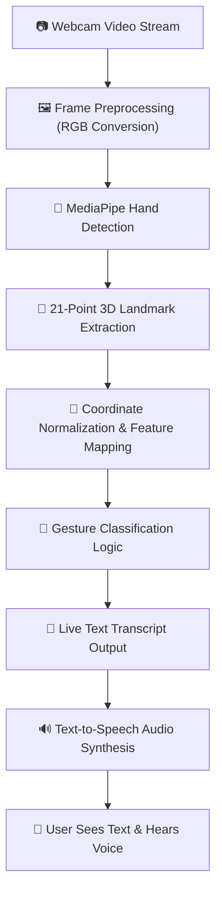

<div align="center">
  <h1>🤟 SignVoice — Sign Language to Voice & Text Conversion</h1>
  <p><strong>Breaking Communication Barriers Through Accessible Computer Vision</strong></p>
  <p>
    An assistive, real-time computer vision web application designed to translate hand gestures into clear readable text and natural spoken audio using a standard computer webcam—without requiring specialized hardware or wearable sensors.
  </p>

  <p>
    
    
    
    
    
    
  </p>

  <p>
    <a href="https://github.com/suryaprakashs0629/Sign-Language-To-Voice-Text-Conversion"><strong>View GitHub Repository »</strong></a>
    &nbsp;&bull;&nbsp;
    <a href="#-installation--setup"><strong>Installation Guide</strong></a>
    &nbsp;&bull;&nbsp;
    <a href="#-running-the-application"><strong>How to Run</strong></a>
    &nbsp;&bull;&nbsp;
    <a href="#-troubleshooting"><strong>Troubleshooting</strong></a>
  </p>
</div>

---

## 📌 Table of Contents
1. [Project Overview](#-project-overview)
2. [Problem Statement & Proposed Solution](#-problem-statement--proposed-solution)
3. [Key Features & Application Modules](#-key-features--application-modules)
4. [Technology Stack](#-technology-stack)
5. [System Architecture & Data Pipeline](#-system-architecture--data-pipeline)
6. [How Gesture Recognition Works](#-how-gesture-recognition-works)
7. [Project Structure](#-project-structure)
8. [Installation & Setup](#-installation--setup)
9. [Running the Application](#-running-the-application)
10. [Browser & Camera Permissions](#-browser--camera-permissions)
11. [Troubleshooting](#-troubleshooting)
12. [Screenshots & Visual Walkthrough](#-screenshots--visual-walkthrough)
13. [Future Enhancements](#-future-enhancements)
14. [Academic Information](#-academic-information)
15. [Contributing](#-contributing)
16. [License](#-license)

---

## 🌍 Project Overview

**SignVoice** (*Sign Language to Voice/Text Conversion*) is a software-driven assistive communication system built to bridge the everyday communication gap between individuals who use sign language and those unfamiliar with it.

By combining a clean, accessible web interface with real-time hand landmark tracking powered by **MediaPipe Hands** and **OpenCV**, the system captures live hand gestures through a standard webcam, interprets the spatial geometry of the fingers and palm, displays the corresponding text transcript on screen, and converts the recognized output into audible speech using **Text-to-Speech (TTS)** synthesis.

### Primary Objectives
- **Hardware-Free Accessibility:** Eliminate dependency on expensive flex-sensor gloves, depth cameras, or proprietary hardware by operating purely on standard laptop or desktop webcams.
- **Real-Time Landmark Detection:** Accurately track 21 3D hand landmarks per hand across live video frames with low latency.
- **Dual-Mode Communication Output:** Deliver simultaneous visual text transcripts and spoken audio output so communication works seamlessly in both quiet and conversational environments.
- **Structured Multi-Page Web Experience:** Provide dedicated interfaces for live translation, visual sign learning, interactive practice, session history, emergency quick-phrases, and technical MediaPipe documentation.
- **Practical Assistive Engineering:** Demonstrate how lightweight computer vision pipelines can run reliably on local consumer hardware.

---

## ❗ Problem Statement & Proposed Solution

### The Problem
Effective communication between deaf or hard-of-hearing sign language users and non-signers remains a major everyday barrier in classrooms, clinics, workplaces, and public spaces. Existing assistive translation tools frequently suffer from one or more limitations:
- **High Hardware Cost:** Sensor-embedded gloves and specialized depth-tracking devices are expensive and impractical for daily carry.
- **Complex Calibration:** Many hardware solutions require frequent per-user calibration and physical maintenance.
- **Limited Accessibility:** Desktop-only command-line prototypes lack intuitive interfaces that non-technical users can operate comfortably.

### The Proposed Solution
**SignVoice** addresses these challenges through an accessible, browser-based computer vision architecture:
1. **Standard Camera Input:** Uses the built-in or USB webcam already present on standard Windows PCs.
2. **Landmark-Based Classification:** Extracts normalized 21-point hand coordinates rather than relying on raw background pixels, improving resilience against minor lighting and background variations.
3. **Instant Text & Voice Output:** Displays recognized signs immediately in a live transcript area and vocalizes phrases via Text-to-Speech.
4. **One-Click Local Execution:** Packages the local server and startup workflow into `Open SignVoice Locally.bat` for straightforward setup and demonstration.

---

## ✨ Key Features & Application Modules

| Feature / Module | Description |
| :--- | :--- |
| 📷 **Real-Time Webcam Capture** | Streams live video frames directly from the user's webcam into the recognition pipeline with mirror-view framing. |
| 🤚 **21-Point Hand Landmark Tracking** | Uses MediaPipe Hands to detect wrist, knuckle, and fingertip coordinates in real time. |
| 🧠 **Gesture Classification Engine** | Evaluates relative finger extension, joint angles, and spatial distances to identify supported signs. |
| 📝 **Live Text Transcript Builder** | Converts recognized gestures into readable words and sentences with clear visual feedback. |
| 🔊 **Text-to-Speech (TTS) Engine** | Vocalizes recognized text aloud through system audio for effortless two-way interaction. |
| 📖 **Sign Language Reference Guide** | Visual sign dictionary and reference pages helping new learners understand hand postures and sign formations. |
| 🎯 **Interactive Practice Mode** | Allows users to test their hand positioning against live landmark feedback to improve recognition accuracy. |
| 🚨 **Emergency Quick-Communication Mode** | Provides rapid access to critical alerts and essential phrases when immediate communication is required. |
| 📊 **Technical Data Sheet & Metrics** | Documents MediaPipe landmark topology, coordinate mapping, and system processing workflow. |
| ♿ **Accessible & Responsive UI** | Built with semantic HTML5, skip-to-content navigation, skeleton loading states, and clean high-contrast typography. |

---

## 🛠️ Technology Stack

| Layer | Technology | Role in System |
| :--- | :--- | :--- |
| **Frontend Structure** | HTML5 | Semantic multi-page layout, accessibility landmarks, and media containers |
| **Frontend Styling** | CSS3 | Responsive grid layouts, custom component styling, and skeleton loading animations |
| **Frontend Logic** | JavaScript (ES6+) | Webcam stream management, UI state updates, history tracking, and browser TTS playback |
| **Backend & Processing** | Python 3.8+ | Local application execution, vision processing scripts, and backend coordination |
| **Hand Tracking** | MediaPipe Hands | Real-time hand detection and 21-landmark 3D coordinate extraction |
| **Computer Vision** | OpenCV (`cv2`) | Frame capture, color-space conversion (`BGR` to `RGB`), and landmark overlay rendering |
| **Speech Synthesis** | Web Speech API / Python TTS | Converting recognized text strings into natural spoken audio |
| **Launcher Automation** | Windows Batch (`.bat`) | Automating local server startup and browser launch via `Open SignVoice Locally.bat` |

---

## 🏗️ System Architecture & Data Pipeline



### Detailed Pipeline Stages

| Stage | Component | Technical Operation |
| :--- | :--- | :--- |
| **1. Input Capture** | Webcam / Browser Media API | Captures continuous video frames at standard webcam frame rates. |
| **2. Preprocessing** | OpenCV / Canvas Pipeline | Flips frame horizontally for natural mirror interaction and converts color channels for MediaPipe ingestion. |
| **3. Hand Localization** | Palm Detector | Identifies the bounding region of the hand within the camera frame. |
| **4. Landmark Extraction** | MediaPipe Hand Landmark Model | Maps **21 anatomical keypoints** (Wrist `0`, Thumb `1–4`, Index `5–8`, Middle `9–12`, Ring `13–16`, Pinky `17–20`). |
| **5. Feature Processing** | Geometry & State Analyzer | Computes relative distances and finger-curl states independent of hand distance from the camera. |
| **6. Sign Recognition** | Classifier / Rule Engine | Matches the extracted landmark vector against trained/defined gesture signatures. |
| **7. Text & Voice Output** | UI Renderer & TTS Engine | Appends the matched label to the text output box and triggers speech synthesis. |

---

## ⚙️ How Gesture Recognition Works

1. **Frame Acquisition:** When the user starts the camera session, video frames are sampled continuously.
2. **Coordinate Mapping:** MediaPipe assigns normalized `(x, y, z)` coordinates to all 21 hand joints:
   - `0`: Wrist base
   - `1–4`: Thumb (CMC, MCP, IP, TIP)
   - `5–8`: Index finger (MCP, PIP, DIP, TIP)
   - `9–12`: Middle finger (MCP, PIP, DIP, TIP)
   - `13–16`: Ring finger (MCP, PIP, DIP, TIP)
   - `17–20`: Pinky finger (MCP, PIP, DIP, TIP)
3. **Posture Evaluation:** The system compares fingertip coordinates against lower joint coordinates (PIP/MCP) to determine whether each finger is extended, bent, or touching another digit.
4. **Stability Filtering:** Consecutive frame confirmation prevents accidental flickering or false triggers during hand transitions.
5. **Multimodal Output:** Once stabilized, the recognized sign updates the on-screen text display and can be read aloud immediately via Text-to-Speech.

---

## 📁 Project Structure

```text
Sign-Language-To-Voice-Text-Conversion/
│
├── index.html                  # Primary web application entry point & translator interface
├── css/
│   └── style.css               # Global styles, responsive layouts, and UI components
├── js/                         # Client-side JavaScript modules (camera, UI logic, TTS, state)
├── python/                     # Python computer vision, OpenCV, and MediaPipe scripts
├── screenshots/                # Application UI and workflow screenshots (for documentation)
├── Open SignVoice Locally.bat  # Automated Windows startup script for local execution
└── README.md                   # Complete project documentation
```

### Key File Descriptions
- **`index.html`**: Houses the core user interface, camera viewport, live translation output panel, and navigation links.
- **`css/style.css`**: Controls typography, layout structure, responsive breakpoints, and accessible visual hierarchy.
- **`js/`**: Manages browser camera permissions, UI interactions, speech synthesis triggers, and session history.
- **`python/`**: Contains the backend Python scripts responsible for MediaPipe hand tracking and gesture recognition logic.
- **`Open SignVoice Locally.bat`**: Simplifies running the project on Windows by launching the local environment automatically.

---

## 💻 Installation & Setup

Follow these steps to set up **SignVoice** on a Windows machine.

### 1. System Requirements
- **Operating System:** Windows 10 or Windows 11 (64-bit)
- **Python Version:** Python 3.8 – 3.11 (recommended for broad MediaPipe compatibility)
- **Web Browser:** Google Chrome or Microsoft Edge (latest version recommended)
- **Camera:** Built-in laptop webcam or external USB webcam
- **Network:** Active internet connection for cloning the repository and installing Python packages

### 2. Download the Repository

#### Method A: Clone with Git (Recommended)
Open **PowerShell** or **Command Prompt** and execute:
```bash
git clone [https://github.com/suryaprakashs0629/Sign-Language-To-Voice-Text-Conversion.git](https://github.com/suryaprakashs0629/Sign-Language-To-Voice-Text-Conversion.git)
cd Sign-Language-To-Voice-Text-Conversion
```

#### Method B: Download ZIP Archive
1. Visit the [GitHub Repository](https://github.com/suryaprakashs0629/Sign-Language-To-Voice-Text-Conversion).
2. Click the green **`<> Code`** button and choose **Download ZIP**.
3. Right-click the downloaded `.zip` file and select **Extract All...**.
4. Open the extracted `Sign-Language-To-Voice-Text-Conversion` folder.

### 3. Verify Python & `pip` Installation
Run the following commands in **PowerShell** or **Command Prompt** to verify Python is properly installed and registered in your system `PATH`:
```bash
python --version
pip --version
```
*(If `python` is not recognized, try `py --version`. If Python is not installed, download it from [python.org/downloads](https://www.python.org/downloads/) and ensure **"Add Python to PATH"** is checked during setup.)*

### 4. Backend Dependencies
Inspect the `python/` directory for a `requirements.txt` file or import list before installing dependencies. Typically, MediaPipe-based vision scripts rely on packages such as `mediapipe` and `opencv-python`:
```bash
# If a requirements.txt file is present inside the python/ folder:
pip install -r python/requirements.txt
```

---

## ▶️ Running the Application

### Method 1: One-Click Windows Launcher (Recommended)
1. Open the extracted **`Sign-Language-To-Voice-Text-Conversion`** folder in File Explorer.
2. Double-click **`Open SignVoice Locally.bat`**.
3. If Windows SmartScreen displays a prompt (*"Windows protected your PC"*), click **More info** → **Run anyway** after confirming the file is from your local project directory.
4. Wait for the local server and backend processes to initialize in the terminal window.
5. Your default web browser will open the application automatically. If it does not open on its own, copy the `http://localhost:<port>` URL printed in the terminal window and paste it into Chrome or Edge.
6. Click **Allow** when the browser requests webcam access.

### Method 2: Running Inside Visual Studio Code
1. Open **Visual Studio Code**.
2. Go to **File → Open Folder...** and select `Sign-Language-To-Voice-Text-Conversion`.
3. Open an integrated terminal via **Terminal → New Terminal** (`Ctrl + Shift + ~`).
4. Run the launcher script from the project root:
   ```cmd
   "Open SignVoice Locally.bat"
   ```
5. To stop the running application at any time, focus the terminal window and press **`Ctrl + C`**.

---

## 📷 Browser & Camera Permissions

Modern browsers enforce strict security rules for hardware access (`getUserMedia`):
- **Use `localhost`, Not `file://`:** Always access the application through the local server URL (`http://localhost:...`) provided by the launcher. Opening `index.html` directly from File Explorer (`file:///...`) may cause browsers to block webcam and module access.
- **Grant Camera Permission:** When prompted by Chrome or Edge, select **Allow** to enable live video capture.
- **Single-App Camera Lock:** Windows allows only one application to access a physical webcam at a time. Ensure Zoom, Microsoft Teams, Discord, OBS, or the Windows Camera app are closed before starting SignVoice.
- **Resetting Blocked Permissions:** If camera access was accidentally blocked earlier, click the **tune / lock icon** on the left side of the browser address bar, set **Camera** to **Allow**, and reload the page.

---

## 🔧 Troubleshooting

| Symptom / Error | Likely Cause | Recommended Fix |
| :--- | :--- | :--- |
| `'python' is not recognized as an internal or external command` | Python is not installed or missing from Windows `PATH` | Reinstall Python with **Add Python to PATH** checked, or replace `python` with `py`. |
| `Open SignVoice Locally.bat` opens and closes immediately | Missing Python library or syntax/path error in script | Open **Command Prompt** in the project folder and run `"Open SignVoice Locally.bat"` to read the error output. |
| Webcam feed stays black or fails to start | Browser permission denied or camera occupied by another app | Close video conferencing apps, allow camera access in browser site settings, and refresh. |
| Hand landmarks do not appear on screen | Hand is outside camera frame or lighting is too dim | Center your hand 1–2 feet from the camera against a plain background with front-facing lighting. |
| Recognized sign flickers between labels | Rapid hand movement or partial finger occlusion | Hold each sign steady for 1–2 seconds with all fingers clearly visible to the lens. |
| Text appears, but no voice audio plays | Browser tab is muted, system volume is low, or TTS voice is unavailable | Unmute the browser tab, check Windows audio output device, and test in Chrome or Edge. |

---

## 🖼️ Screenshots & Visual Walkthrough

> To display screenshots on GitHub, save PNG/JPG captures inside a `screenshots/` folder in the repository root using the filenames below.

| Screen / Module | Preview | Description |
| :--- | :--- | :--- |
| **Home & Overview** | `` | Landing interface introducing SignVoice features and navigation |
| **Live Translator View** | `` | Real-time webcam viewport with 21-point MediaPipe hand skeleton overlay |
| **Text & Speech Output** | `` | Recognized gesture transcript panel with Text-to-Speech controls |
| **Sign Reference Guide** | `` | Visual sign dictionary and posture reference for learners |

---

## 🚀 Future Enhancements

- 📚 **Expanded Sign Vocabulary:** Extend recognition from static signs to dynamic two-handed gestures and full conversational phrases (supporting Indian Sign Language & ASL).
- 🧠 **Deep Learning Sequence Classification:** Integrate LSTM or Transformer-based temporal models trained on landmark sequences for continuous sentence recognition.
- 🌐 **Multilingual Text & Speech Output:** Support translating recognized signs into regional Indian languages (such as Kannada, Hindi, and Tamil) alongside English.
- 📱 **Mobile Browser Support:** Optimize camera resolution scaling and touch interactions for Android and iOS mobile browsers.
- 📈 **Confidence Score & Feedback HUD:** Display real-time prediction confidence percentages and posture alignment hints during practice mode.
- 💾 **Exportable Transcripts:** Allow users to download or copy conversation logs for classroom and consultation notes.

---

## 🎓 Academic Information

| Attribute | Details |
| :--- | :--- |
| **Project Title** | Sign Language to Voice/Text Conversion (`SignVoice`) |
| **Institution** | Atria Institute of Technology, Bengaluru |
| **Project Category** | ASIP Project (Application-Oriented / Academic Innovation Project) |
| **Academic Year** | 2026–2027 |
| **Domain** | Computer Vision, Human-Computer Interaction & Assistive Technology |
| **Repository** | [github.com/suryaprakashs0629/Sign-Language-To-Voice-Text-Conversion](https://github.com/suryaprakashs0629/Sign-Language-To-Voice-Text-Conversion) |

---

## 🤝 Contributing

Contributions, bug reports, and feature enhancements are welcome!

1. **Fork** the repository on GitHub.
2. **Clone** your fork locally:
   ```bash
   git clone [https://github.com/](https://github.com/)<your-username>/Sign-Language-To-Voice-Text-Conversion.git
   ```
3. **Create a feature branch:**
   ```bash
   git checkout -b feature/your-feature-name
   ```
4. **Commit your changes** with a clear message:
   ```bash
   git commit -m "Add: brief description of your improvement"
   ```
5. **Push** to your branch:
   ```bash
   git push origin feature/your-feature-name
   ```
6. Open a **Pull Request** describing what was changed and why.

---

## 📜 License

This repository does not currently specify an open-source license. Unless a `LICENSE` file is added, all rights remain reserved by the project author(s) for academic and educational demonstration purposes.

---

<div align="center">
  <p><strong>🤟 Technology for Accessibility. Innovation for Everyone.</strong></p>
  <p>Developed at Atria Institute of Technology • If you found this project helpful, consider giving it a ⭐ Star on GitHub!</p>
</div>