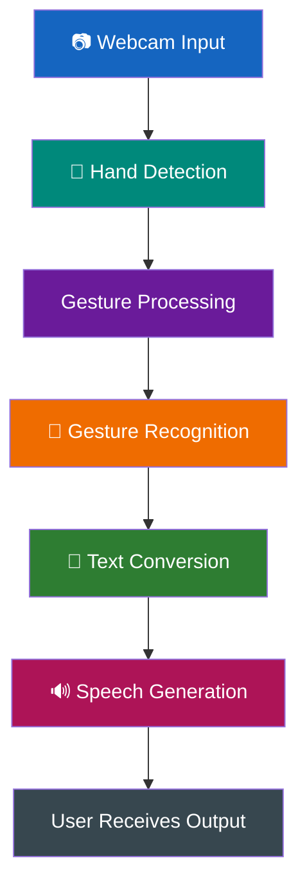

# 🤟 Sign Language to Voice & Text Conversion

### Breaking Communication Barriers Through Technology

An accessible, camera-based sign language recognition project designed to convert hand gestures into understandable text and speech.

<p align="center">


</p>

---

## 📌 Table of Contents

| No. | Section |
|---:|---|
| 01 | [Project Overview](#-project-overview) |
| 02 | [Problem Statement](#-problem-statement) |
| 03 | [Proposed Solution](#-proposed-solution) |
| 04 | [Project Objectives](#-project-objectives) |
| 05 | [Key Features](#-key-features) |
| 06 | [Technology Stack](#-technology-stack) |
| 07 | [System Architecture](#-system-architecture) |
| 08 | [Working Methodology](#-working-methodology) |
| 09 | [Project Structure](#-project-structure) |
| 10 | [Installation and Setup](#-installation-and-setup) |
| 11 | [How to Run the Website](#-how-to-run-the-website) |
| 12 | [Camera Permissions](#-camera-permissions) |
| 13 | [Troubleshooting](#-troubleshooting) |
| 14 | [Future Enhancements](#-future-enhancements) |
| 15 | [Screenshots](#-screenshots) |
| 16 | [Academic Information](#-academic-information) |
| 17 | [Contributing](#-contributing) |
| 18 | [License](#-license) |

---

## 🌍 Project Overview

**Sign Language to Voice & Text Conversion** is an assistive technology project that aims to simplify communication between individuals who use sign language and individuals who may not understand it.

The project explores the use of computer vision, hand gesture recognition and web technologies to interpret hand gestures and convert them into readable text and speech.

By using commonly available hardware such as a webcam and computer, the project aims to provide an accessible alternative to specialized communication devices.

### 🎯 Why This Project?

Communication should not be limited by language barriers.

This project explores how technology can help make communication more inclusive through gesture recognition and speech generation.

---

## ❗ Problem Statement

Communication between sign language users and people unfamiliar with sign language can be challenging.

Traditional communication methods may require an interpreter or specialized assistance.

There is a need for an accessible software-based solution that can recognize hand gestures and translate them into understandable text and speech.

This project addresses that challenge by exploring a camera-based gesture recognition system.

---

## 💡 Proposed Solution

The proposed system uses a webcam to capture hand gestures.

The captured input is processed using the application's gesture recognition workflow. Recognized gestures are then converted into readable text and can be presented through speech output.

The system combines frontend web technologies and Python-based application components to provide an interactive experience.

---

## 🎯 Project Objectives

- 📷 Capture hand gestures using a webcam.
- 🤚 Detect and process hand movements.
- 🧠 Explore gesture recognition using computer vision.
- 📝 Convert recognized gestures into readable text.
- 🔊 Generate speech from recognized text.
- 💻 Develop an accessible and user-friendly interface.
- ♿ Explore technology-driven communication accessibility.

---

## ✨ Key Features

| Feature | Description |
|---|---|
| 📷 Camera Integration | Uses camera input to capture hand gestures. |
| 🤚 Hand Detection | Identifies hands from visual input. |
| 🧠 Gesture Recognition | Processes gestures to identify corresponding signs. |
| 📝 Text Conversion | Represents recognized gestures as readable text. |
| 🔊 Voice Output | Provides speech output from recognized text. |
| 💻 Web Interface | Provides an interactive browser-based interface. |
| ♿ Accessibility | Explores assistive communication technology. |
| 💰 Cost-Effective Approach | Designed around commonly available computer hardware. |

---

## 🛠️ Technology Stack

The project combines web development technologies with Python-based processing.

| Technology | Category | Purpose |
|---|---|---|
| HTML5 | Frontend | Structures the website. |
| CSS3 | Frontend | Controls layout, styling and appearance. |
| JavaScript | Frontend | Handles interactive website functionality. |
| Python | Backend | Supports application-side processing. |
| Computer Vision | Processing | Supports visual input processing. |
| Webcam | Hardware | Captures hand gestures. |
| Text-to-Speech | Output | Converts text into spoken audio. |

### Technology Categories

| Layer | Technologies |
|---|---|
| User Interface | HTML, CSS |
| Client-Side Logic | JavaScript |
| Application Processing | Python |
| Input | Webcam |
| Output | Text and Speech |

---

## 🏗️ System Architecture

The following diagram illustrates the general workflow of the proposed system.



### Architecture Explanation

| Stage | Component | Description |
|---:|---|---|
| 1 | Camera Input | Captures hand gestures. |
| 2 | Hand Detection | Detects hands from camera input. |
| 3 | Gesture Processing | Processes the captured visual information. |
| 4 | Recognition | Identifies the corresponding gesture. |
| 5 | Text Conversion | Produces readable text. |
| 6 | Speech Generation | Produces speech from text. |
| 7 | Output | Presents the result to the user. |

---

## ⚙️ Working Methodology

The application follows a sequence of processing stages.

### Step 1 – Camera Input

The webcam captures the user's hand gestures.

### Step 2 – Hand Detection

The application processes camera input to detect the hand.

### Step 3 – Gesture Processing

The captured visual information is processed for recognition.

### Step 4 – Gesture Recognition

The application identifies the corresponding gesture.

### Step 5 – Text Conversion

The recognized gesture is represented as readable text.

### Step 6 – Voice Generation

The recognized text is converted into speech through the speech output mechanism.

### Step 7 – User Output

The resulting text and speech provide an alternative communication method.

---

## 📁 Project Structure

The main project directory is organized into the following components.

```text
Sign-Language-To-Voice-Text-Conversion/
│
├── index.html
│
├── css/
│   └── style.css
│
├── js/
│   └── JavaScript files
│
├── python/
│   └── Python application files
│
├── Open SignVoice Locally.bat
│
└── README.md
```

### File and Folder Description

| File / Directory | Description |
|---|---|
| `index.html` | Main website entry point. |
| `css/` | Contains website stylesheets. |
| `js/` | Contains JavaScript resources. |
| `python/` | Contains Python application components. |
| `Open SignVoice Locally.bat` | Windows launcher for starting the application. |
| `README.md` | Project documentation. |

*Note: The structure above shows the main components. Individual filenames may vary depending on the repository version.*

---

## 💻 Installation and Setup

Follow these instructions to download and run the project on Windows.

### 1. System Requirements

| Requirement | Recommended |
|---|---|
| Operating System | Windows 10 / Windows 11 |
| Python | Version required by the project |
| Code Editor | Visual Studio Code |
| Web Browser | Google Chrome or Microsoft Edge |
| Camera | Working webcam |
| Internet | Required for downloading the repository and dependencies |

### 2. Download the Repository

There are two ways to obtain the project.

**Method A – Clone using Git**

Open Command Prompt or VS Code terminal.

Execute:

```bash
git clone https://github.com/suryaprakashs0629/Sign-Language-To-Voice-Text-Conversion.git
```

Navigate into the project folder:

```bash
cd Sign-Language-To-Voice-Text-Conversion
```

**Method B – Download ZIP**

1. Open the GitHub repository.
2. Click the green **Code** button.
3. Select **Download ZIP**.
4. Extract the downloaded ZIP file.
5. Open the extracted project folder.

### 3. Install Python

If Python is already installed, proceed to the next step.

Otherwise:

1. Visit [Python Official Website](https://www.python.org/downloads/).
2. Download a compatible Python version.
3. Run the installer.
4. Enable **Add Python to PATH**.
5. Complete the installation.

### 4. Verify Python Installation

Open Command Prompt or PowerShell.

Run:

```bash
python --version
```

Alternatively:

```bash
py --version
```

A successful installation displays the installed Python version.

### 5. Open the Project in VS Code

1. Launch Visual Studio Code.
2. Select **File → Open Folder**.
3. Navigate to the extracted project directory.
4. Select the project folder.
5. Click **Select Folder**.

The project files will appear in the VS Code Explorer.

---

## ▶️ How to Run the Website

The project includes a Windows startup file:

**`Open SignVoice Locally.bat`**

Follow the steps below.

### Method 1 – Using the Windows Launcher (Recommended)

| Step | Instruction |
|---:|---|
| 1 | Open the extracted project directory. |
| 2 | Locate `Open SignVoice Locally.bat`. |
| 3 | Double-click the batch file. |
| 4 | Wait for the startup process to complete. |
| 5 | Check whether the browser opens automatically. |
| 6 | If required, open the local address displayed by the launcher. |
| 7 | Allow camera access when prompted. |
| 8 | Start using the application. |

### Method 2 – Using Visual Studio Code

1. Open the project folder in VS Code.
2. Select **Terminal → New Terminal**.
3. Make sure the terminal is in the project root directory.
4. Run the supplied Windows launcher:

```powershell
.\Open SignVoice Locally.bat
```

5. Wait for the application to start.
6. Follow the instructions displayed in the terminal.

### Stopping the Application

If the application is running in a terminal, press:

```text
Ctrl + C
```

This stops the running application process.

> **Important:** Use the supplied launcher rather than guessing manual Python commands. The exact dependencies and startup commands depend on the current backend configuration.

---

## 📷 Camera Permissions

The application requires camera access for gesture input.

When the browser displays a camera permission request:

1. Click **Allow**.
2. Select the correct webcam if multiple cameras are available.
3. Ensure that no other application is blocking the camera.
4. Refresh the website if access was previously denied.

### Camera Troubleshooting

| Issue | Solution |
|---|---|
| Camera does not open | Check browser camera permissions. |
| Black camera screen | Check camera connection and selected device. |
| Camera already in use | Close other applications using the webcam. |
| Poor gesture detection | Improve lighting and hand positioning. |

---

## 🔧 Troubleshooting

| Problem | Possible Solution |
|---|---|
| Python is not recognized | Install Python and configure PATH. |
| Website does not open | Check whether the launcher completed successfully. |
| Launcher closes immediately | Run it from a terminal to inspect the error. |
| Camera permission denied | Enable camera access in browser settings. |
| Camera is unavailable | Check webcam connection and other applications. |
| No speech output | Check system volume and browser audio settings. |
| Gesture not recognized | Improve lighting and keep the hand visible. |
| Application fails to start | Inspect the terminal output for missing dependencies or errors. |

---

## 🚀 Future Enhancements

The following are possible areas for future development.

| Enhancement | Description |
|---|---|
| 📚 Larger Gesture Vocabulary | Expand the number of supported signs. |
| 🌐 Multiple Languages | Support different spoken languages. |
| 🧠 Improved Recognition | Explore more advanced gesture recognition models. |
| 📱 Mobile Compatibility | Extend the application to mobile platforms. |
| ⚡ Better Performance | Improve processing speed and recognition reliability. |
| ☁️ Cloud Integration | Explore cloud-based processing and updates. |
| 📊 Performance Evaluation | Evaluate recognition accuracy using larger datasets. |
| ♿ Accessibility Improvements | Add more accessibility-focused features. |

---

## 📸 Screenshots

Application screenshots and demonstrations can be added here to showcase the actual working interface.

Recommended screenshots:

| Screenshot | Description |
|---|---|
| Home Page | Main application interface. |
| Camera Interface | Live camera input. |
| Gesture Recognition | Gesture detection interface. |
| Text Output | Recognized text. |
| Voice Output | Speech output demonstration. |

### Adding Screenshots

1. Create a folder named `screenshots` in the project root.
2. Save your actual screenshots inside it.
3. Add the following Markdown wherever you want the screenshot displayed:

```markdown

```

---

## 🎓 Academic Information

| Detail | Information |
|---|---|
| Project Title | Sign Language to Voice/Text Conversion |
| Institution | Atria Institute of Technology |
| Project Category | ASIP Project |
| Academic Year | 2026–27 |
| Domain | Computer Vision and Assistive Technology |

### Project Goal

To explore the application of computer vision and gesture recognition technologies in improving communication accessibility.

---

## 🤝 Contributing

Contributions, suggestions and improvements are welcome.

If you would like to contribute:

1. Fork this repository.
2. Create a new branch.
3. Make your changes.
4. Commit your changes.
5. Push your branch.
6. Submit a Pull Request.

---

## 📜 License

No license has currently been specified for this repository.

---

## ⭐ Support the Project

If you find this project interesting, consider giving the repository a ⭐ Star.

Your support is appreciated and encourages further development.

---

### 🤟 Technology for Accessibility. Innovation for Everyone.

**Developed as an academic project at Atria Institute of Technology.**

**Repository:** [Sign Language to Voice & Text Conversion](https://github.com/suryaprakashs0629/Sign-Language-To-Voice-Text-Conversion)